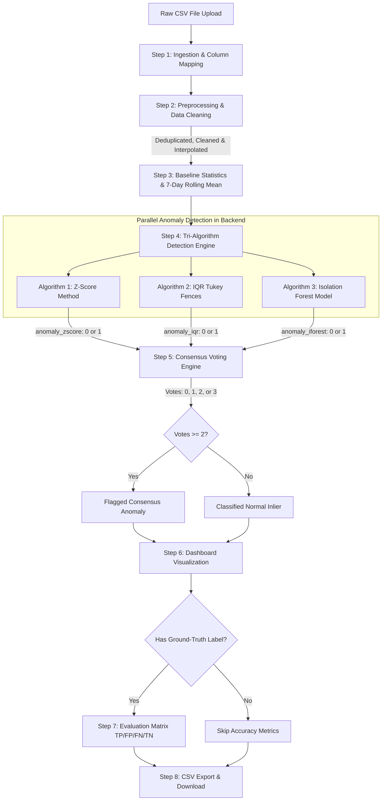
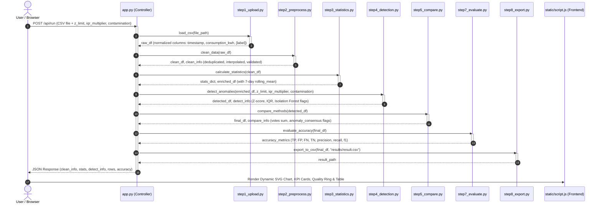
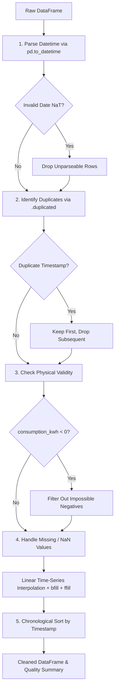
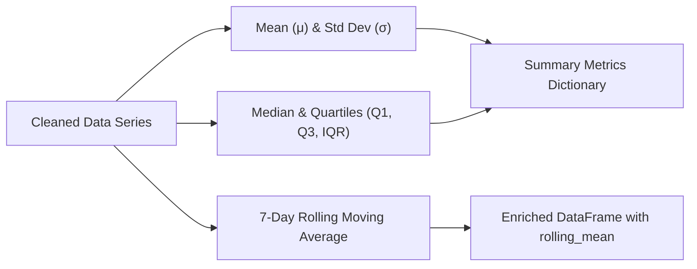
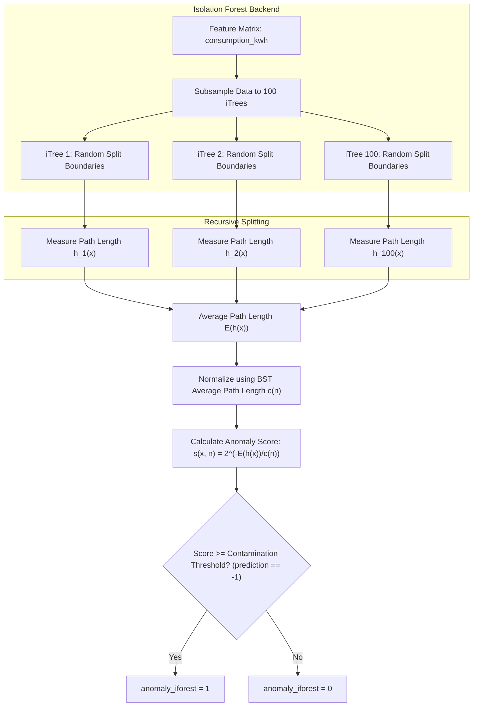
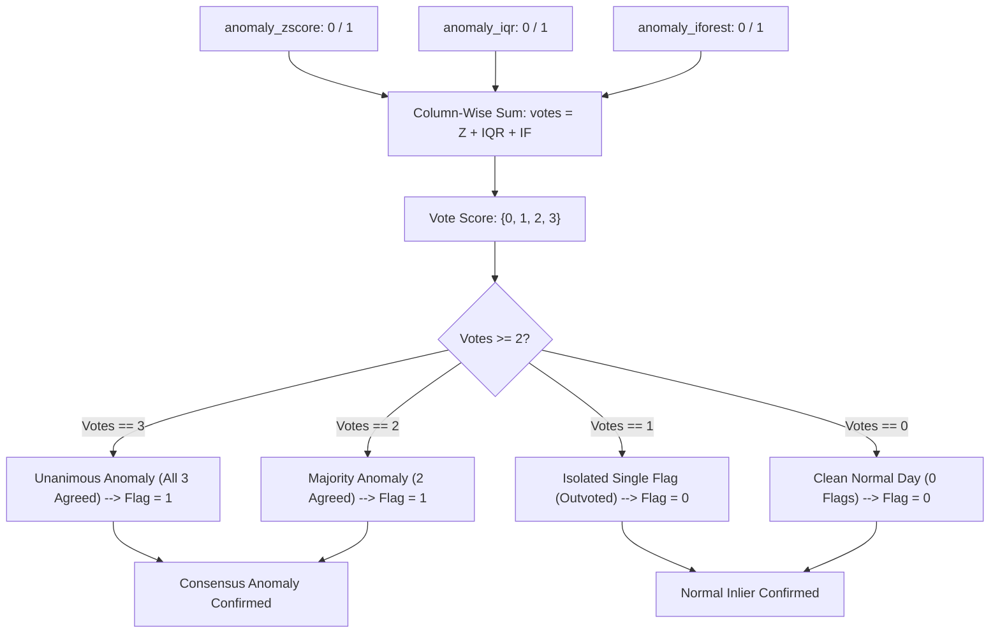
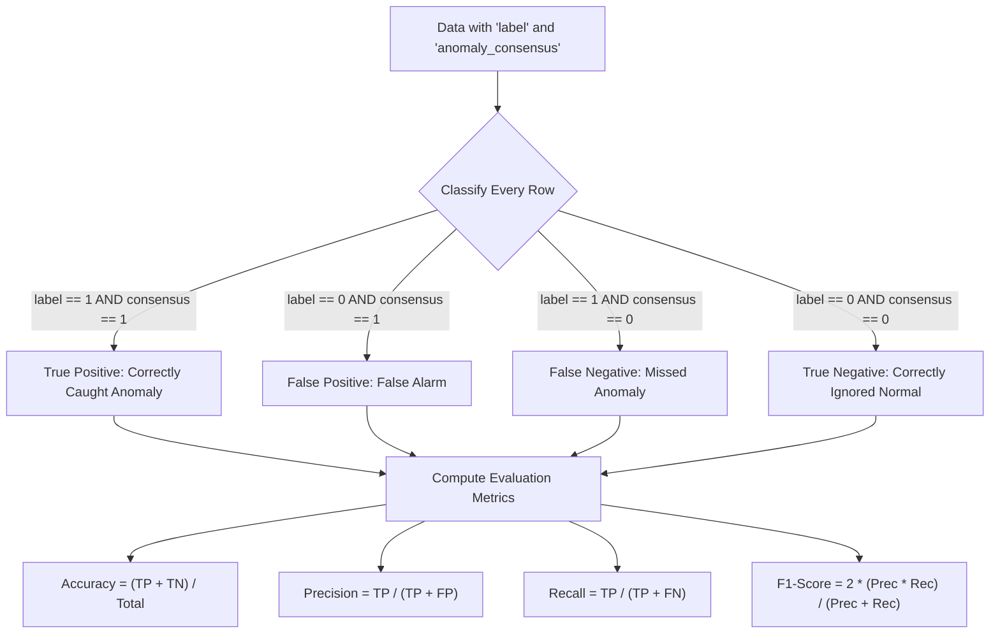

# ⚡ Electricity Consumption Anomaly Detection System (WattWatch)

An end-to-end, interpretable machine learning and statistical analytics system designed to detect irregular electricity consumption patterns (such as equipment surges, meter bypasses, power theft, and hardware malfunctions) from smart meter time-series data.

The system combines three independent, complementary anomaly detection algorithms—**Z-Score (Parametric Statistical)**, **Interquartile Range (IQR / Tukey's Fences - Non-Parametric)**, and **Isolation Forest (Unsupervised Machine Learning Ensemble)**—with a **Consensus Voting Engine** to maximize detection reliability and minimize false alarms.

---

## 📑 Table of Contents

1. [System Architecture & Working Flow](#-system-architecture--working-flow)
   - [High-Level Pipeline Flowchart](#high-level-pipeline-flowchart)
   - [End-to-End Execution Sequence Diagram](#end-to-end-execution-sequence-diagram)
   - [Client-Backend System Architecture](#client-backend-system-architecture)
2. [Backend Module Execution & Algorithmic Mechanics](#-backend-module-execution--algorithmic-mechanics)
   - [Step 1: Data Ingestion & Column Mapping (`step1_upload.py`)](#step-1-data-ingestion--column-mapping-step1_uploadpy)
   - [Step 2: Preprocessing & Data Cleaning (`step2_preprocess.py`)](#step-2-preprocessing--data-cleaning-step2_preprocesspy)
   - [Step 3: Statistical Baseline Profiling (`step3_statistics.py`)](#step-3-statistical-baseline-profiling-step3_statisticspy)
   - [Step 4: Tri-Algorithm Anomaly Detection Engine (`step4_detection.py`)](#step-4-tri-algorithm-anomaly-detection-engine-step4_detectionpy)
     - [4.1 Algorithm 1: Z-Score (Statistical Distance)](#41-algorithm-1-z-score-statistical-distance)
     - [4.2 Algorithm 2: Interquartile Range (Tukey's Fences)](#42-algorithm-2-interquartile-range-tukeys-fences)
     - [4.3 Algorithm 3: Isolation Forest (ML Ensemble Tree)](#43-algorithm-3-isolation-forest-ml-ensemble-tree)
   - [Step 5: Consensus Voting Engine (`step5_compare.py`)](#step-5-consensus-voting-engine-step5_comparepy)
   - [Step 6: Interactive Dashboard & UI Visualization](#step-6-interactive-dashboard--ui-visualization)
   - [Step 7: Ground-Truth Evaluation Matrix (`step7_evaluate.py`)](#step-7-ground-truth-evaluation-matrix-step7_evaluatepy)
   - [Step 8: CSV Export & Reporting (`step8_export.py`)](#step-8-csv-export--reporting-step8_exportpy)
3. [Complete Step-by-Step Numerical Worked Example](#-complete-step-by-step-numerical-worked-example)
   - [1. Sample Raw Dataset](#1-sample-raw-dataset)
   - [2. Step 2: Cleaning in Action](#2-step-2-cleaning-in-action)
   - [3. Step 3: Statistical Calculations (Manual Math)](#3-step-3-statistical-calculations-manual-math)
   - [4. Step 4: Anomaly Detection Calculations](#4-step-4-anomaly-detection-calculations)
   - [5. Step 5: Consensus Voting Verdict](#5-step-5-consensus-voting-verdict)
   - [6. Step 7: Evaluation Metrics Calculation](#6-step-7-evaluation-metrics-calculation)
4. [Configurable Hyperparameters](#-configurable-hyperparameters)
5. [Project Directory Structure](#-project-directory-structure)
6. [API Reference](#-api-reference)
7. [Installation & How to Run](#-installation--how-to-run)

---

## 🏗️ System Architecture & Working Flow

The system processes smart meter data through a modular 8-step pipeline. The backend is orchestrated by **Flask**, numerical processing is executed via **NumPy** and **Pandas**, machine learning isolation trees are driven by **Scikit-Learn**, and the presentation layer uses modern vanilla CSS and JavaScript with an interactive SVG time-series visualizer.

### High-Level Pipeline Flowchart



---

### End-to-End Execution Sequence Diagram

The following sequence diagram details how `app.py` coordinates the user request across each discrete backend module:



---

### Client-Backend System Architecture

```text
+---------------------------------------------------------------------------------------------------+
|                                       CLIENT (WEB BROWSER)                                        |
|  - Drag-and-drop CSV Dropzone         - Config Slider Controls (Z-Limit, IQR-k, Contamination)     |
|  - Dynamic SVG Time-Series Chart      - Color-Coded Scatter Markers (Amber Outliers / Teal Clean) |
|  - Data Health Circular Progress Ring - Filterable & Searchable Results Table                     |
+---------------------------------------------------------------------------------------------------+
                                         │                    ▲
                          POST /api/run  │                    │ JSON Response (Records,
                          (CSV + Params) │                    │ Metrics, Health Ring, Accuracy)
                                         ▼                    │
+---------------------------------------------------------------------------------------------------+
|                                      BACKEND PIPELINE (FLASK)                                     |
|                                                                                                   |
|  [Step 1: Upload]     --> Standardize columns: 'timestamp', 'consumption_kwh', ['label']          |
|  [Step 2: Clean]      --> Parse ISO dates, drop duplicates, filter < 0 kWh, linear interpolation  |
|  [Step 3: Statistics] --> Mean (μ), Std Dev (σ), Median, Quartiles (Q1, Q3), 7-Day Moving Avg     |
|                                                                                                   |
|  [Step 4: Detection]  --> [Z-Score Engine]          [IQR Fences]          [Isolation Forest]      |
|                               |                          |                       |                |
|  [Step 5: Consensus]  -------> Sum Votes = (Z_flag + IQR_flag + IF_flag)                          |
|                               Consensus Flag = 1 IF Votes >= 2 ELSE 0                             |
|                                                                                                   |
|  [Step 7: Evaluate]   --> (If 'label' present) Compute Confusion Matrix, Precision, Recall, F1    |
|  [Step 8: Export]     --> Generate formatted 'result.csv' for instant download                     |
+---------------------------------------------------------------------------------------------------+
```

---

## 🔬 Backend Module Execution & Algorithmic Mechanics

### Step 1: Data Ingestion & Column Mapping (`step1_upload.py`)

Smart meter logs originate from various utility platforms, SCADA systems, or IoT data loggers. Column headers frequently vary across providers. 

The ingestion module inspects the CSV header and maps heterogeneous column aliases into an internal canonical schema:

| Target Canonical Field | Accepted Aliases in CSV | Data Type | Description |
|---|---|---|---|
| `timestamp` | `timestamp`, `date`, `datetime`, `time`, `reading_date` | String / Datetime | Observation date or timestamp |
| `consumption_kwh` | `consumption_kwh`, `consumption`, `kwh`, `usage`, `units`, `power` | Float | Electricity consumption in kilowatt-hours |
| `label` *(Optional)* | `label`, `is_anomaly`, `anomaly`, `actual` | Integer (0 or 1) | Ground-truth benchmark for validation |

#### Backend Mechanics
1. Reads CSV using `pd.read_csv(file_path)`.
2. Normalizes column headers: `.strip().lower().replace(" ", "_")`.
3. Matches aliases using predefined dictionary lists.
4. If either `timestamp` or `consumption_kwh` is missing, raises a `ValueError` with clear guidance.

---

### Step 2: Preprocessing & Data Cleaning (`step2_preprocess.py`)

Raw sensor feeds frequently suffer from missing packets, communication timeouts, duplicate transmissions, and sensor glitches. Step 2 applies a 5-stage cleaning pipeline:



#### Detailed Cleaning Actions
1. **Date Parsing & Bad Row Rejection**:
   Dates are converted via `pd.to_datetime(df['timestamp'], errors='coerce')`. Any unparseable strings are coerced into `NaT` (Not-a-Time) and dropped.
2. **Deduplication**:
   If a meter sends two readings for the same timestamp, the first valid reading is retained and subsequent duplicates are purged:
   $$\text{Duplicates Removed} = N_{\text{initial}} - N_{\text{unique\_timestamps}}$$
3. **Negative Value Elimination**:
   Standard residential or commercial consumption cannot physically be negative:
   $$\text{Mask: } \text{consumption\_kwh} < 0 \implies \text{Purged}$$
4. **Time-Series Linear Interpolation**:
   When sensors experience momentary drops resulting in missing or `NaN` values, time-series linear interpolation connects adjacent points:
   $$y = y_0 + (x - x_0) \cdot \frac{y_1 - y_0}{x_1 - x_0}$$
   Boundary missing values at the beginning or end of the series are resolved via backward-fill (`bfill()`) followed by forward-fill (`ffill()`).
5. **Chronological Sorting**:
   The entire dataset is sorted ascending by `timestamp` to ensure accurate rolling-window statistics.

---

### Step 3: Statistical Baseline Profiling (`step3_statistics.py`)

Before applying detection algorithms, the system computes descriptive statistics across all valid readings $X = \{x_1, x_2, \dots, x_N\}$:



#### 1. Arithmetic Mean ($\mu$)
Expected daily consumption baseline:
$$\mu = \frac{1}{N} \sum_{i=1}^{N} x_i$$

#### 2. Sample Variance ($s^2$) & Standard Deviation ($\sigma$)
Quantifies the natural dispersion or spread of consumption:
$$s^2 = \frac{1}{N - 1} \sum_{i=1}^{N} (x_i - \mu)^2, \qquad \sigma = \sqrt{s^2}$$

#### 3. Median ($x_{\text{med}}$)
The 50th percentile, unaffected by extreme outliers. For sorted values $x_{(1)} \le x_{(2)} \le \dots \le x_{(N)}$:
$$\text{Median} = \begin{cases} x_{\left(\frac{N+1}{2}\right)}, & \text{if } N \text{ is odd} \\ \frac{1}{2}\left(x_{\left(\frac{N}{2}\right)} + x_{\left(\frac{N}{2}+1\right)}\right), & \text{if } N \text{ is even} \end{cases}$$

#### 4. Quartiles & Interquartile Range ($IQR$)
- First Quartile ($Q_1$): 25th percentile (25% of observations fall below this mark).
- Third Quartile ($Q_3$): 75th percentile (75% of observations fall below this mark).
$$IQR = Q_3 - Q_1$$

#### 5. 7-Day Rolling Moving Average ($\text{Trend}_t$)
Computed via `series.rolling(window=7, min_periods=1).mean()`. This smooths out short-term weekday-vs-weekend fluctuations to reveal the true underlying trend:
$$\text{Rolling Mean}_t = \frac{1}{W} \sum_{j=0}^{W-1} x_{t-j} \quad \text{where } W = 7 \text{ days}$$

---

### Step 4: Tri-Algorithm Anomaly Detection Engine (`step4_detection.py`)

To ensure robust detection across both Gaussian and skewed distributions, three complementary algorithms evaluate each day's consumption in parallel:

```text
┌────────────────────────────────────────────────────────────────────────┐
│                        ALGORITHM SUITE TRADEOFFS                       │
├───────────────────┬──────────────────────────────────┬─────────────────┤
│ Algorithm         │ Best Suited For                  │ Limitation      │
├───────────────────┼──────────────────────────────────┼─────────────────┤
│ 1. Z-Score        │ Symmetrical, bell-shaped curves  │ Sensitive to    │
│                   │ and extreme multi-sigma spikes   │ extreme spikes  │
│ 2. IQR Fences     │ Skewed data, non-normal trends,  │ Rigid step      │
│                   │ robust to massive outliers       │ boundaries      │
│ 3. Isolation      │ Multi-modal distributions,       │ Non-deterministic│
│    Forest         │ subtle density variations        │ stochastic trees│
└───────────────────┴──────────────────────────────────┴─────────────────┘
```

---

#### 4.1 Algorithm 1: Z-Score (Statistical Distance)

The Z-Score measures the standardized distance between an individual consumption reading $x_i$ and the historical mean $\mu$ in units of standard deviation $\sigma$.

```mermaid
flowchart TD
    A[consumption_kwh Series] --> B[Compute Sample Mean μ]
    A --> C["Compute Sample Std Dev σ (ddof=1)"]
    C --> D{Is σ == 0?}
    D -->|Yes| E[Set σ = 1e-9 to prevent division by zero]
    D -->|No| F[Keep computed σ]
    B --> G["Compute Z-Score: Z = (x - μ) / σ"]
    E --> G
    F --> G
    G --> H["Evaluate Absolute Value |Z| > z_limit"]
    H -->|True| I[anomaly_zscore = 1 (Flagged)]
    H -->|False| J[anomaly_zscore = 0 (Normal)]
```

- **Mathematical Equation**:
  $$Z_i = \frac{x_i - \mu}{\sigma}$$
- **Decision Rule**:
  $$\text{anomaly\_zscore}_i = \begin{cases} 1, & \text{if } |Z_i| > z_{\text{limit}} \\ 0, & \text{otherwise} \end{cases}$$
- **Backend Implementation Mechanics**:
  - Uses `series.mean()` and `series.std(ddof=1)`.
  - Protected against zero-variance files (constant consumption) by setting $\sigma = 10^{-9}$ if $\sigma = 0$.
  - Generates `result_df["z_score"]` and vectorized binary flag `result_df["anomaly_zscore"]`.

---

#### 4.2 Algorithm 2: Interquartile Range (Tukey's Fences)

Tukey's Fences method relies on percentiles and ranks rather than the mean. Because it calculates the spread of only the middle 50% of readings, it is completely immune to massive spikes that distort the standard deviation.

```mermaid
flowchart TD
    A[consumption_kwh Series] --> B["Compute Q1 = 25th Percentile"]
    A --> C["Compute Q3 = 75th Percentile"]
    B --> D["Compute IQR = Q3 - Q1"]
    C --> D
    D --> E["Calculate Lower Bound = Q1 - (k * IQR)"]
    D --> F["Calculate Upper Bound = Q3 + (k * IQR)"]
    A --> G{"Is x < Lower Bound OR x > Upper Bound?"}
    E --> G
    F --> G
    G -->|Yes| H[anomaly_iqr = 1 (Flagged)]
    G -->|No| I[anomaly_iqr = 0 (Normal)]
```

- **Mathematical Equations**:
  $$\text{IQR} = Q_3 - Q_1$$
  $$\text{Lower Bound} = Q_1 - (k \times IQR)$$
  $$\text{Upper Bound} = Q_3 + (k \times IQR)$$
  where $k = \text{iqr\_multiplier}$ (default $k = 1.5$).
- **Decision Rule**:
  $$\text{anomaly\_iqr}_i = \begin{cases} 1, & \text{if } x_i < \text{Lower Bound} \;\lor\; x_i > \text{Upper Bound} \\ 0, & \text{otherwise} \end{cases}$$
- **Backend Implementation Mechanics**:
  - Evaluated using `series.quantile(0.25)` and `series.quantile(0.75)`.
  - Generates boolean vector mask `(series < lower_bound) | (series > upper_bound)`.
  - Converts boolean mask to integers `(0 or 1)` in `result_df["anomaly_iqr"]`.

---

#### 4.3 Algorithm 3: Isolation Forest (ML Ensemble Tree)

Isolation Forest (*Liu, Ting, Zhou - IEEE ICDM*) is an unsupervised machine learning ensemble based on decision trees. Instead of modeling normal cluster boundaries, it exploits two fundamental quantitative properties of anomalies:
1. They are the **minority** (few in number).
2. They have **attribute values radically different** from normal instances.



- **Tree Isolation Logic**:
  - Outliers sit in sparse regions. A random cut between $[\min(x), \max(x)]$ isolates an outlier in very few splits (short path length $h(x) \approx 1$).
  - Normal points sit clustered together and require many successive cuts to separate (deep path length $h(x) \gg 1$).
- **Mathematical Equations**:
  $$c(n) = 2 \left( \ln(n - 1) + 0.5772156649 \right) - \frac{2(n - 1)}{n}$$
  $$s(x, n) = 2^{-\frac{\mathbb{E}(h(x))}{c(n)}}$$
- **Backend Implementation Mechanics**:
  - Instantiates `sklearn.ensemble.IsolationForest(contamination=contamination, random_state=42)`.
  - Calls `model.fit_predict(df[["consumption_kwh"]])`.
  - Scikit-Learn outputs `-1` for anomalies and `+1` for normal instances.
  - The backend maps this output directly to binary format: `(preds == -1).astype(int)`.

---

### Step 5: Consensus Voting Engine (`step5_compare.py`)

A single model acting alone can be misled by dataset skew, high variance, or stochastic splits. The consensus engine requires multiple models to confirm an anomaly before alerting the user:



- **Decision Formula**:
  $$\text{Votes}_i = \text{anomaly\_zscore}_i + \text{anomaly\_iqr}_i + \text{anomaly\_iforest}_i \quad \in \{0, 1, 2, 3\}$$
  $$\text{anomaly\_consensus}_i = \begin{cases} 1, & \text{if } \text{Votes}_i \ge 2 \\ 0, & \text{if } \text{Votes}_i < 2 \end{cases}$$
- **False Alarm Elimination**: If a single model triggers a false alarm on a slightly unusual day ($Votes = 1$), the remaining two models outvote it, ensuring only true irregularities are flagged.

---

### Step 6: Interactive Dashboard & UI Visualization

The results are dynamically rendered on the frontend dashboard:
- **Interactive SVG Time-Series Chart**: Plots daily consumption alongside the 7-day rolling average. Points flagged by consensus are marked with distinct amber highlights with hoverable tooltips.
- **Data Health Ring**: An SVG circle displaying the percentage of clean, valid readings after preprocessing:
  $$\text{Data Health \%} = \frac{N_{\text{clean}}}{N_{\text{raw}}} \times 100$$
- **KPI Summary Cards**: Summarizes Total Consumption, Average Daily Use, Detected Outliers, and Peak Value.
- **Interactive Data Table**: Searchable, filterable (All, Normal, Anomalies, Disputed), with color-coded badges for each algorithm's verdict.

---

### Step 7: Ground-Truth Evaluation Matrix (`step7_evaluate.py`)

When the uploaded CSV contains a `label` column ($1 = \text{true anomaly}, 0 = \text{normal}$), the backend validates the consensus predictions against ground truth:



| Metric | Formula | What It Tells Us |
|---|---|---|
| **Accuracy** | $\frac{\text{TP} + \text{TN}}{\text{TP} + \text{TN} + \text{FP} + \text{FN}}$ | Overall percentage of days classified correctly |
| **Precision** | $\frac{\text{TP}}{\text{TP} + \text{FP}}$ | Of all days flagged as anomalies, what percentage were real anomalies? |
| **Recall** | $\frac{\text{TP}}{\text{TP} + \text{FN}}$ | Of all actual anomalies that occurred, what percentage did the system catch? |
| **F1-Score** | $2 \times \frac{\text{Precision} \times \text{Recall}}{\text{Precision} + \text{Recall}}$ | Harmonic balance between precision and recall |

---

### Step 8: CSV Export & Reporting (`step8_export.py`)

The final analyzed dataset is written to `results/result.csv` containing:
- Standardized timestamps and consumption readings
- 7-day rolling moving average
- Computed Z-Scores
- Individual flags: `anomaly_zscore`, `anomaly_iqr`, `anomaly_iforest`
- Total `votes` ($0$ to $3$)
- Final verdict: `anomaly_consensus` ($0$ or $1$)

Users can download this file directly via the browser or the `/api/download` endpoint.

---

## 🧮 Complete Step-by-Step Numerical Worked Example

To understand the exact math executed under the hood, let's trace a small 6-day sample dataset with one massive power surge on Day 5.

### 1. Sample Raw Dataset

| Day | Date | Raw Reading (`consumption_kwh`) | Actual Status (`label`) |
|:---:|:---:|:---:|:---:|
| 1 | `2026-01-01` | **30.0 kWh** | 0 (Normal) |
| 2 | `2026-01-02` | **32.0 kWh** | 0 (Normal) |
| 3 | `2026-01-03` | **31.0 kWh** | 0 (Normal) |
| 4 | `2026-01-04` | **29.0 kWh** | 0 (Normal) |
| 5 | `2026-01-05` | **95.0 kWh** *(Extreme Surge)* | 1 (True Anomaly) |
| 6 | `2026-01-06` | **30.0 kWh** | 0 (Normal) |

---

### 2. Step 2: Cleaning in Action
- All dates are valid ISO formats (`YYYY-MM-DD`).
- No duplicate dates exist.
- No negative values ($x_i \ge 0$).
- No missing values (`NaN`).
- Result: $N = 6$ valid rows retained ($100\%$ Data Health).

---

### 3. Step 3: Statistical Calculations (Manual Math)

#### Mean ($\mu$):
$$\sum x_i = 30 + 32 + 31 + 29 + 95 + 30 = 247$$
$$\mu = \frac{247}{6} \approx \mathbf{41.167 \text{ kWh}}$$

#### Variance ($s^2$) and Standard Deviation ($\sigma$):
Calculate deviations $(x_i - \mu)$ and squared deviations $(x_i - \mu)^2$:

| Day | $x_i$ | $(x_i - \mu)$ | $(x_i - \mu)^2$ |
|:---:|:---:|:---:|:---:|
| 1 | 30.0 | $30 - 41.167 = -11.167$ | $124.702$ |
| 2 | 32.0 | $32 - 41.167 = -9.167$ | $84.034$ |
| 3 | 31.0 | $31 - 41.167 = -10.167$ | $103.368$ |
| 4 | 29.0 | $29 - 41.167 = -12.167$ | $148.036$ |
| 5 | 95.0 | $95 - 41.167 = +53.833$ | $2898.024$ |
| 6 | 30.0 | $30 - 41.167 = -11.167$ | $124.702$ |
| **Sum** | **247.0** | **0.000** | **3482.866** |

$$s^2 = \frac{\sum (x_i - \mu)^2}{N - 1} = \frac{3482.866}{6 - 1} = \frac{3482.866}{5} \approx \mathbf{696.573}$$
$$\sigma = \sqrt{696.573} \approx \mathbf{26.393 \text{ kWh}}$$

#### Quartiles & Interquartile Range ($IQR$):
First, sort the array in ascending order:
$$\text{Sorted } X = [29.0, \; 30.0, \; 30.0, \; 31.0, \; 32.0, \; 95.0]$$

Using linear percentile interpolation:
- $Q_1$ (25th percentile) $= \mathbf{30.0 \text{ kWh}}$
- Median (50th percentile) $= \frac{30.0 + 31.0}{2} = \mathbf{30.5 \text{ kWh}}$
- $Q_3$ (75th percentile) $= \mathbf{31.75 \text{ kWh}}$
$$IQR = Q_3 - Q_1 = 31.75 - 30.0 = \mathbf{1.75 \text{ kWh}}$$

---

### 4. Step 4: Anomaly Detection Calculations

Let's test Day 5 ($x_5 = 95.0\text{ kWh}$) and Day 1 ($x_1 = 30.0\text{ kWh}$):

#### Method 1: Z-Score (with $z_{\text{limit}} = 3.0$)
- **For Day 1 ($30.0\text{ kWh}$)**:
  $$Z_1 = \frac{30.0 - 41.167}{26.393} = \frac{-11.167}{26.393} \approx \mathbf{-0.42}$$
  Since $|-0.42| \le 3.0 \implies \mathbf{\text{anomaly\_zscore} = 0}$ (Normal).

- **For Day 5 ($95.0\text{ kWh}$)**:
  $$Z_5 = \frac{95.0 - 41.167}{26.393} = \frac{+53.833}{26.393} \approx \mathbf{+2.04}$$
  *(Note: Because $N=6$ is small, the single outlier of 95 artificially inflated $\sigma$ from $1.1$ to $26.4$, pulling the Z-score to 2.04. On standard threshold $3.0$, Z-Score flags 0. This demonstrates why multi-algorithm voting is vital!)*

#### Method 2: IQR Fences (with $k = 1.5$)
- **Compute Boundaries**:
  $$\text{Lower Bound} = Q_1 - (1.5 \times IQR) = 30.0 - (1.5 \times 1.75) = 30.0 - 2.625 = \mathbf{27.375 \text{ kWh}}$$
  $$\text{Upper Bound} = Q_3 + (1.5 \times IQR) = 31.75 + (1.5 \times 1.75) = 31.75 + 2.625 = \mathbf{34.375 \text{ kWh}}$$

- **Evaluate Days**:
  - Day 1: $27.375 \le 30.0 \le 34.375 \implies \mathbf{\text{anomaly\_iqr} = 0}$ (Normal).
  - Day 5: $95.0 > 34.375 \implies \mathbf{\text{anomaly\_iqr} = 1}$ (Anomaly Flagged!).

#### Method 3: Isolation Forest (with `contamination = 0.16`)
- The inliers $\{29, 30, 30, 31, 32\}$ form a tight cluster between $29$ and $32$.
- A single split anywhere between $32.1$ and $94.9$ (e.g., $x \ge 60$) immediately isolates $95.0\text{ kWh}$ into an external leaf node at depth $h=1$.
- Because its path length is extremely short, its anomaly score approaches $1.0$.
- Result: Day 5 is classified as an outlier ($\text{prediction} = -1 \implies \mathbf{\text{anomaly\_iforest} = 1}$).

---

### 5. Step 5: Consensus Voting Verdict

Tallying all votes for the sample data:

| Day | Date | $x_i$ (kWh) | Z-Score ($|Z|>3.0$) | IQR ($>34.4$) | I-Forest | Total Votes | Consensus ($\ge 2$) | Final Verdict |
|:---:|:---:|:---:|:---:|:---:|:---:|:---:|:---:|:---:|
| 1 | `2026-01-01` | 30.0 | 0 | 0 | 0 | **0** | **0** | Normal |
| 2 | `2026-01-02` | 32.0 | 0 | 0 | 0 | **0** | **0** | Normal |
| 3 | `2026-01-03` | 31.0 | 0 | 0 | 0 | **0** | **0** | Normal |
| 4 | `2026-01-04` | 29.0 | 0 | 0 | 0 | **0** | **0** | Normal |
| 5 | `2026-01-05` | 95.0 | 0 | 1 | 1 | **2** | **1** | 🚨 **ANOMALY** |
| 6 | `2026-01-06` | 30.0 | 0 | 0 | 0 | **0** | **0** | Normal |

Even though Z-score was dampened by the small sample size, **IQR and Isolation Forest both caught the anomaly**, giving Day 5 **2 votes** and successfully classifying it as a **Consensus Anomaly**.

---

### 6. Step 7: Evaluation Metrics Calculation

Comparing our consensus output against the ground truth labels:
- **Day 1 to 4 & 6**: Label = 0, Consensus = 0 $\implies \mathbf{4 \text{ True Negatives (TN)}}$
- **Day 5**: Label = 1, Consensus = 1 $\implies \mathbf{1 \text{ True Positive (TP)}}$
- **False Positives (FP)**: 0
- **False Negatives (FN)**: 0

Calculating evaluation metrics:
$$\text{Accuracy} = \frac{TP + TN}{Total} = \frac{1 + 4}{6} = \frac{5}{6} \approx \mathbf{83.3\%}$$
$$\text{Precision} = \frac{TP}{TP + FP} = \frac{1}{1 + 0} = \mathbf{1.000 \; (100\%)}$$
$$\text{Recall} = \frac{TP}{TP + FN} = \frac{1}{1 + 0} = \mathbf{1.000 \; (100\%)}$$
$$\text{F1-Score} = 2 \times \frac{1.0 \times 1.0}{1.0 + 1.0} = \mathbf{1.000}$$

---

## ⚙️ Configurable Hyperparameters

The application exposes 3 user-tunable hyperparameters via the web interface:

| Hyperparameter | UI Field | Default | Range | Description & Sensitivity |
|---|---|:---:|:---:|---|
| **Z-Score Limit** | `z_limit` | `3.0` | `1.5 - 5.0` | Lowering this (e.g. to `2.0`) makes the system more sensitive to minor fluctuations. Raising it (e.g. to `3.5`) flags only extreme multi-sigma spikes. |
| **IQR Multiplier** | `iqr_multiplier` | `1.5` | `1.0 - 3.0` | Corresponds to Tukey's outer fence multiplier $k$. $1.5$ flags standard outliers; $3.0$ flags only extreme outliers. |
| **Contamination** | `contamination` | `0.05` | `0.01 - 0.20` | The expected proportion of anomalies in the dataset for Isolation Forest ($0.05 = 5\%$). |

---

## 📁 Project Directory Structure

```text
Electricity_Consumption_Anomaly_Detection_System/
│
├── app.py                      # Flask application orchestrator & REST API endpoints
├── requirements.txt            # Python dependencies (Flask, pandas, numpy, scikit-learn)
├── documentation.txt           # Comprehensive system architecture & math notes
├── README.md                   # Complete technical reference manual
│
├── step1_upload.py             # Step 1: File ingestion & column standardizer
├── step2_preprocess.py         # Step 2: Deduplication, bad date handling & interpolation
├── step3_statistics.py         # Step 3: Mean, std dev, quartiles & 7-day rolling mean
├── step4_detection.py          # Step 4: Z-Score, IQR, and Isolation Forest algorithms
├── step5_compare.py            # Step 5: Vote tallying & consensus decision engine
├── step7_evaluate.py           # Step 7: Confusion matrix, Precision, Recall, F1 evaluation
├── step8_export.py             # Step 8: Serialization to result.csv
│
├── templates/
│   └── index.html              # Responsive web dashboard UI
│
├── static/
│   ├── style.css               # Clean modern design system
│   └── script.js               # Client controller, API client & SVG chart renderer
│
├── sample_data/
│   ├── electricity.csv         # Labeled 90-day real-world test series
│   └── electricity_unlabelled.csv # Unlabeled test series for real-world simulation
│
├── uploads/                    # Temporary storage for uploaded CSV files
└── results/                    # Storage for processed result.csv downloads
```

---

## 🔌 API Reference

### 1. `POST /api/run`
Executes the full 8-step anomaly detection pipeline on an uploaded CSV file.

- **Content-Type**: `multipart/form-data`
- **Form Fields**:
  - `file`: The `.csv` file.
  - `z_limit` *(float, optional)*: Default `3.0`.
  - `iqr_multiplier` *(float, optional)*: Default `1.5`.
  - `contamination` *(float, optional)*: Default `0.05`.
- **JSON Response Format**:
  ```json
  {
    "success": true,
    "statistics": {
      "mean": 31.42,
      "median": 30.10,
      "std_dev": 8.75,
      "min": 12.40,
      "max": 95.00,
      "iqr": 4.20
    },
    "detection_summary": {
      "zscore_count": 3,
      "iqr_count": 5,
      "iforest_count": 5,
      "consensus_anomalies": 4
    },
    "cleaning_summary": {
      "initial_rows": 90,
      "final_rows": 90,
      "data_health_percent": 100.0
    },
    "evaluation": {
      "has_label": true,
      "precision": 1.0,
      "recall": 0.8,
      "f1_score": 0.889,
      "accuracy": 98.9
    },
    "data": [
      {
        "timestamp": "2026-01-01",
        "consumption_kwh": 30.0,
        "rolling_mean": 30.0,
        "z_score": -0.16,
        "anomaly_zscore": 0,
        "anomaly_iqr": 0,
        "anomaly_iforest": 0,
        "votes": 0,
        "anomaly_consensus": 0
      }
    ]
  }
  ```

### 2. `GET /api/sample`
Returns the path and metadata for pre-packaged sample datasets to allow one-click testing without manual file uploads.

### 3. `GET /api/download`
Streams the generated `results/result.csv` file directly to the client browser.

---

## 🚀 Installation & How to Run

### Prerequisites
- Python 3.9, 3.10, 3.11, or 3.12
- `pip` package manager

### 1. Clone the Repository
```bash
git clone https://github.com/adityaph-17/Electricity_Consumption_Anomaly_Detection_System.git
cd Electricity_Consumption_Anomaly_Detection_System
```

### 2. Set Up a Virtual Environment (Recommended)
```bash
# macOS / Linux
python3 -m venv venv
source venv/bin/activate

# Windows
python -m venv venv
venv\Scripts\activate
```

### 3. Install Dependencies
```bash
pip install -r requirements.txt
```

### 4. Start the Application
```bash
python app.py
```

### 5. Access the Web Dashboard
Open your browser and navigate to:
```text
http://127.0.0.1:5000
```

Upload either `sample_data/electricity.csv` or your own utility smart meter CSV to instantly view anomalies, adjust hyperparameter sliders, explore the interactive chart, and export results!
